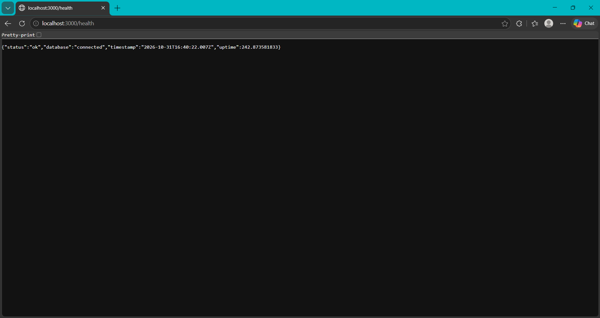
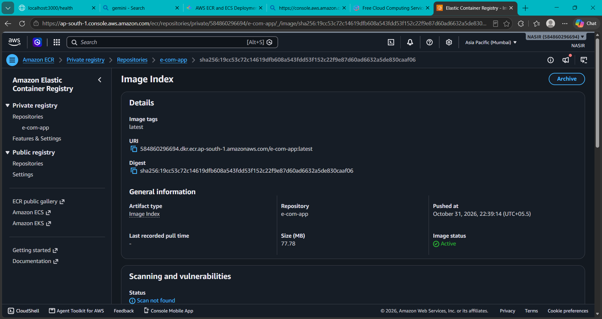
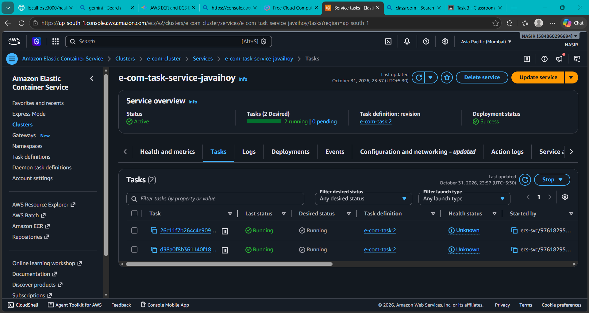
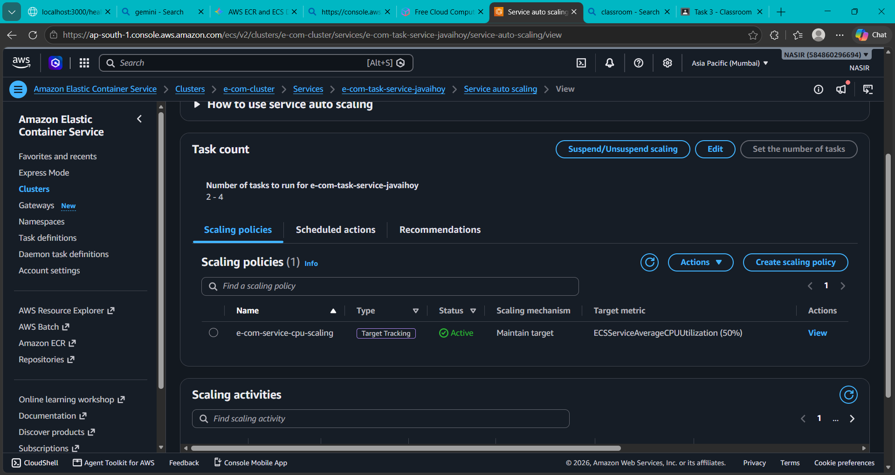

# Task 3 — AWS E-Commerce Application Deployment

[](https://aws.amazon.com/)
[](https://www.docker.com/)
[](https://aws.amazon.com/ecs/)
[](https://aws.amazon.com/ecr/)
[](https://www.postgresql.org/)

## Objective

Deploy the containerized e-commerce application on AWS, connect it to a PostgreSQL database, publish the Docker image to Amazon ECR, run the application through Amazon ECS, and configure service auto scaling for resilient operation.

## Project Overview

Task 3 moved the e-commerce application from local Docker execution to an AWS-managed container deployment. The application health endpoint returned a successful response with `"status":"ok"` and `"database":"connected"`. The production container image was stored in the private `e-com-app` ECR repository and consumed by the ECS service.

The captured AWS console evidence shows:

- ECR image repository: `e-com-app`
- AWS Region: `ap-south-1` (Asia Pacific — Mumbai)
- Image tag: `latest`
- Image status: `Active`
- Image size: `77.78 MB`
- ECS cluster: `e-com-cluster`
- ECS service: `e-com-task-service-javaihoy`
- Task definition: `e-com-task:2`
- Desired tasks: `2`
- Running tasks: `2`
- Pending tasks: `0`
- Deployment status: `Success`
- Service auto scaling range: `2–4` tasks
- CPU target-tracking policy: `50%`

## Architecture Overview

The implementation evidence supplied for this task describes the following request and data flow:

```text
User
  |
  v
Application Load Balancer (HTTP :80)
  |
  v
ECS Service
  |
  v
Docker container (application :3000)
  |
  v
Amazon RDS for PostgreSQL (:5432)
```

The screenshots directly verify the container image, ECS service, running tasks, scaling policy, and database health response. The load balancer, networking, and database resources are documented from the implementation evidence supplied with the task.

## AWS Services Used

| Service | Role in Task 3 |
|---|---|
| Amazon ECS | Runs the containerized application service and maintains the desired task count. |
| Amazon ECR | Stores the private `e-com-app:latest` container image. |
| Amazon RDS for PostgreSQL | Provides the application database named `shop`. |
| Application Load Balancer | Receives HTTP traffic on port 80 and forwards requests to the application target on port 3000. |
| IAM | Provides AWS permissions required by the ECS task and deployment workflow. |
| VPC | Provides the network boundary for the application and database resources. |
| Security Groups | Restrict load balancer, application, and database traffic. |
| Docker | Builds the deployable application image. |
| CloudWatch | Supports ECS operational visibility and service monitoring. |

## Infrastructure Components

- **Container image:** `e-com-app:latest`, stored in private ECR.
- **ECS cluster:** `e-com-cluster`.
- **ECS service:** `e-com-task-service-javaihoy`.
- **Task definition:** `e-com-task:2`.
- **Application port:** `3000`.
- **Database:** PostgreSQL RDS instance, database `shop`, user `appuser`.
- **Load balancer listener:** HTTP port `80`.
- **Target group:** HTTP port `3000`.
- **Health check path:** `/health`.
- **Service scaling:** minimum `2`, maximum `4`, target CPU utilization `50%`.

## Implementation Steps

1. Built the e-commerce application image with Docker.
2. Created the private ECR repository `e-com-app`.
3. Tagged the local image for the Mumbai-region ECR registry.
4. Authenticated Docker to ECR and pushed the `latest` image.
5. Created the ECS cluster `e-com-cluster`.
6. Registered task definition revision `e-com-task:2`.
7. Configured the ECS service to run two application tasks.
8. Configured the application container to listen on port `3000`.
9. Connected the application to the PostgreSQL RDS database using task environment variables.
10. Configured the HTTP load-balancing and health-check flow described above.
11. Added ECS target-tracking auto scaling for 2–4 tasks at 50% average CPU utilization.
12. Validated application and database health through `/health`.

## Security Configuration

The supplied implementation evidence identifies separate traffic controls for the load balancer, application, and database:

- Load balancer security group: HTTP `80` from the intended client network.
- Application security group: TCP `3000` from the load balancer security group.
- Database security group: PostgreSQL `5432` from the application security group.
- Database credentials and JWT secrets were supplied to the task through configuration values rather than hard-coded application routes.
- The ECR repository was private.

Secrets shown in deployment configuration are intentionally not reproduced in this repository.

## Application Deployment Process

The deployment flow was:

```text
Docker build
  -> ECR tag
  -> ECR push
  -> ECS task definition revision
  -> ECS service deployment
  -> Running ECS tasks
  -> Health-check validation
```

The ECR screenshot confirms an active `e-com-app:latest` image with a recorded digest. The ECS screenshot confirms a successful deployment with two running tasks and no pending tasks.

## Database Configuration

The application was configured to use Amazon RDS for PostgreSQL with the following application-level settings:

```text
DB_NAME=shop
DB_USER=appuser
DB_PORT=5432
DB_HOST=<RDS endpoint>
```

Database connectivity was validated through the application health endpoint. The supplied evidence also records SQL verification of the `products` table and a count of `12` product rows.

## Load Balancer Configuration

The supplied implementation evidence records an Application Load Balancer configured with:

- HTTP listener on port `80`
- Target group forwarding to application port `3000`
- Health check path `/health`
- Successful target registration and health checks

The provided screenshots do not expose the ALB DNS name, so it is intentionally represented as a placeholder in this documentation.

## Validation and Testing

The following results were captured or supplied as implementation evidence:

- `http://localhost:3000/health` returned HTTP application health JSON.
- Health response reported `"status":"ok"`.
- Health response reported `"database":"connected"`.
- ECR image status was `Active`.
- ECS service status was `Active`.
- ECS deployment status was `Success`.
- ECS service showed `2 running` and `0 pending` tasks.
- ECS service auto scaling showed an active CPU target-tracking policy at `50%`.
- Database verification returned `12` rows from the `products` table.

Example health response:

```json
{
  "status": "ok",
  "database": "connected",
  "timestamp": "2026-10-31T16:40:22.007Z",
  "uptime": 242.873581833
}
```

## Troubleshooting Performed

The implementation evidence records troubleshooting for:

- ECS task startup failures
- Incorrect task environment variables
- RDS connectivity problems
- Security group rules
- Target group health-check failures
- ECR authentication and image-push issues

Troubleshooting was completed by checking task status, validating configuration values, confirming network access between application and database tiers, and rechecking the health endpoint after each correction.

## Challenges Faced

- Coordinating image naming, tagging, and registry authentication between Docker and ECR.
- Ensuring the ECS task received the correct database endpoint and application configuration.
- Allowing only the required application-to-database traffic through security groups.
- Getting the load balancer health check to reach the application on port `3000`.
- Maintaining a minimum of two healthy application tasks while enabling controlled scale-out.

## Solutions Applied

- Standardized the image as `e-com-app:latest` in the private ECR repository.
- Updated the ECS task configuration with the required application and database variables.
- Restricted database access to the application security group on PostgreSQL port `5432`.
- Used `/health` as the application and target-group health endpoint.
- Configured ECS target tracking with a 50% CPU target and a 2–4 task range.
- Revalidated both container health and database connectivity after deployment changes.

## Learning Outcomes

- Built and published a production-oriented Docker image to Amazon ECR.
- Deployed a versioned ECS task definition and managed it through an ECS service.
- Applied container port mapping between an ECS task, target group, and application.
- Connected a containerized service to PostgreSQL on Amazon RDS.
- Designed security-group traffic flow between load balancer, application, and database tiers.
- Used ECS service auto scaling to maintain capacity between two and four tasks.
- Troubleshot image, configuration, networking, and health-check failures using AWS console evidence.

## Professional Summary

Task 3 delivered a running, database-backed e-commerce service on AWS. The application image was stored in a private ECR repository, deployed through ECS task definition revision `2`, and maintained by an active service with two running tasks. The deployment was further hardened with segmented security-group access, load-balancer health checks, and CPU-based ECS auto scaling from two to four tasks.

## Screenshots

Store the screenshots in `Task-3/screenshots/` using these filenames:

### Application Health Check



### Amazon ECR Image



### ECS Running Tasks



### ECS Service Auto Scaling



## GitHub Project Description

AWS e-commerce application deployment using Docker, Amazon ECR, Amazon ECS, Amazon RDS PostgreSQL, Application Load Balancer health checks, security groups, and CPU-based ECS service auto scaling.

## Suggested Repository Topics

`aws` `devops` `docker` `ecs` `ecr` `rds` `postgresql` `alb` `cloud-computing` `linux` `containerization` `autoscaling` `infrastructure`

## Suggested Commit Messages

```text
docs(task-3): document AWS e-commerce deployment architecture
feat(task-3): publish e-commerce image to private ECR
feat(task-3): deploy e-commerce service on ECS
feat(task-3): configure ECS CPU target tracking from 2 to 4 tasks
docs(task-3): add health, ECR, ECS, and autoscaling evidence
```
