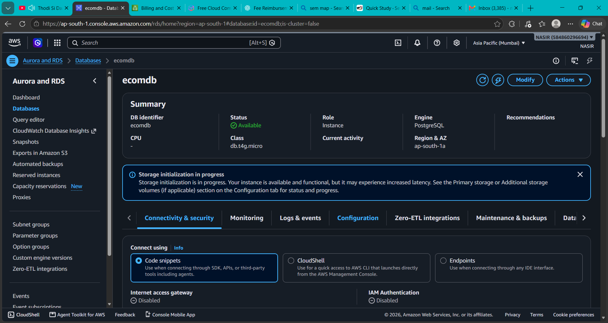
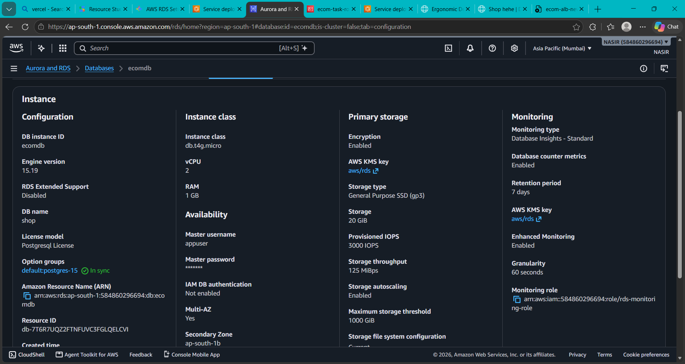
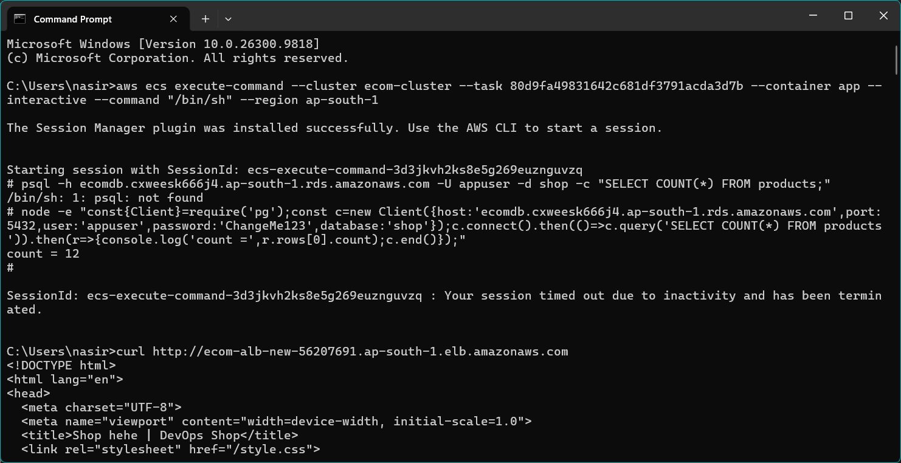
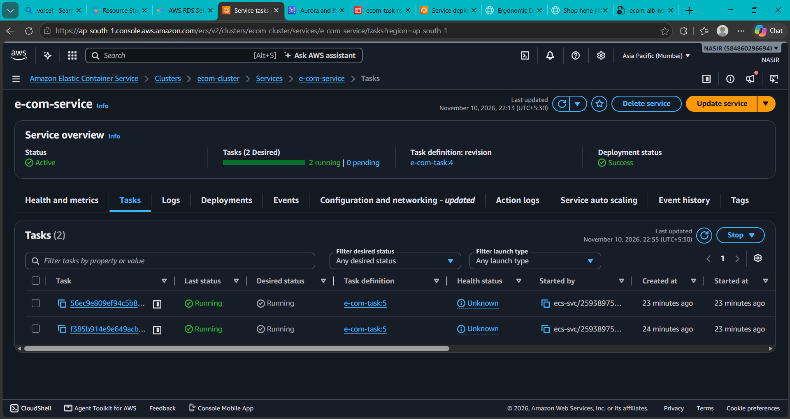
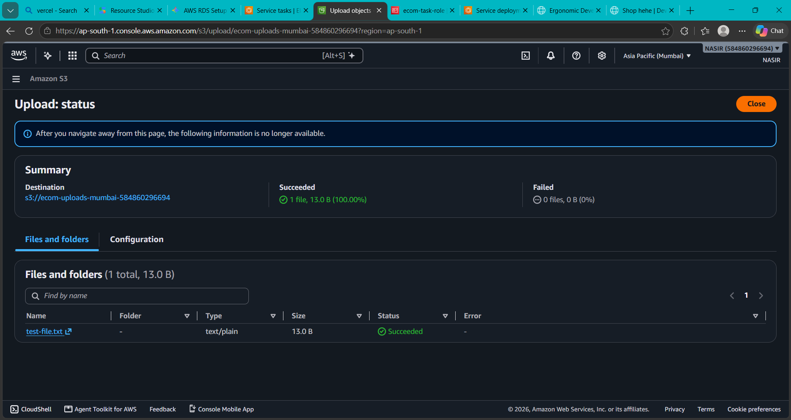
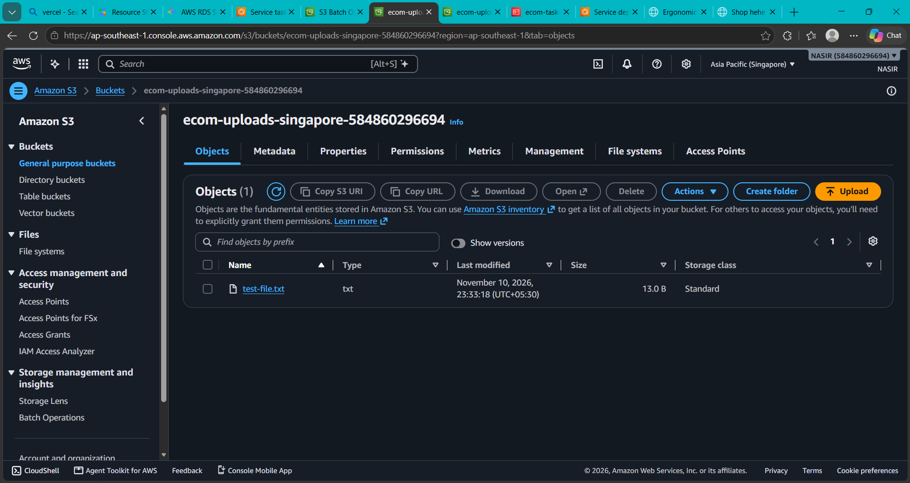
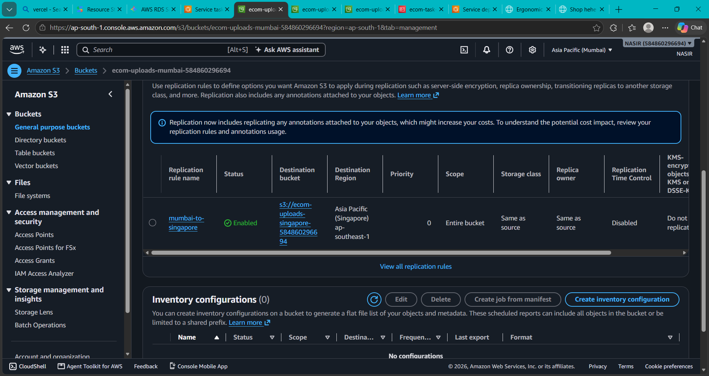
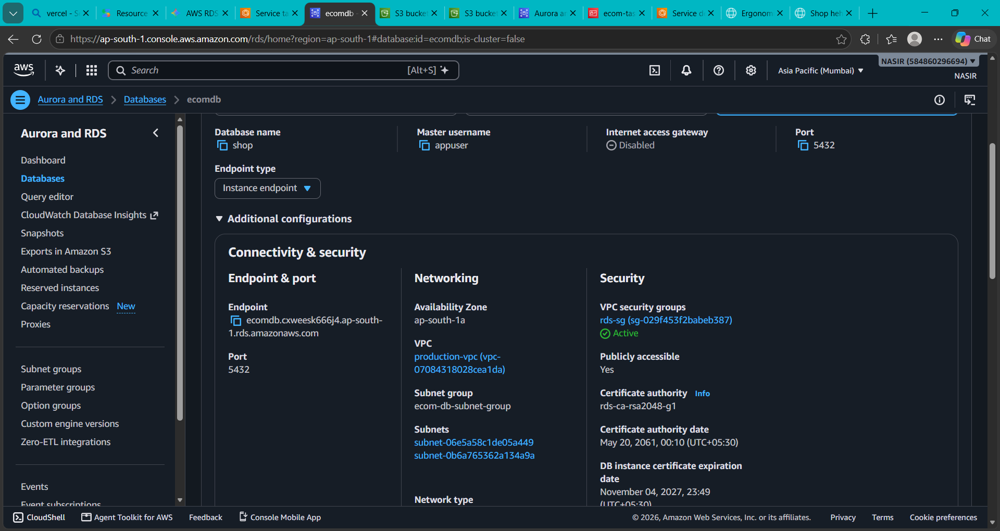

# Task 4 — Production E-Commerce Environment with ECS, RDS, and S3 Replication

[](https://aws.amazon.com/)
[](https://aws.amazon.com/ecs/)
[](https://aws.amazon.com/rds/)
[](https://aws.amazon.com/s3/)

## Objective

Build a production-oriented environment for the e-commerce application using Amazon ECS, PostgreSQL on Amazon RDS, an Application Load Balancer, and Amazon S3 cross-region replication.

## Project Overview

Task 4 extended the container deployment into a production environment in the `ap-south-1` Mumbai Region. The evidence shows an available PostgreSQL database, two running ECS tasks, successful database validation from inside an ECS task, ALB-served application content, a successful S3 upload in Mumbai, and an enabled replication rule to Singapore.

## Evidence Summary

| Area | Verified result |
|---|---|
| AWS Region | `ap-south-1` — Asia Pacific (Mumbai) |
| RDS instance | `ecomdb`, PostgreSQL, status `Available` |
| RDS database | `shop`, port `5432`, user `appuser` |
| RDS availability | Multi-AZ enabled; secondary zone `ap-south-1b` |
| ECS cluster | `ecom-cluster` |
| ECS service | `e-com-service` |
| ECS tasks | `2 desired`, `2 running`, `0 pending` |
| ECS deployment | `Success` |
| Database validation | `SELECT COUNT(*) FROM products;` returned `12` |
| S3 Mumbai bucket | `ecom-uploads-mumbai-584860296694` |
| S3 upload | `test-file.txt`, `13.0 B`, succeeded |
| S3 Singapore bucket | `ecom-uploads-singapore-584860296694` |
| Replication rule | `mumbai-to-singapore`, enabled |
| ALB validation | ALB hostname returned the Shop application HTML |

## Architecture Overview

```text
Internet user
      |
      v
Application Load Balancer
      |
      v
ECS service: e-com-service
      |
  +---+---+
  |       |
Task 1  Task 2
      |
      v
Amazon RDS PostgreSQL

Amazon S3: Mumbai bucket
      |
      | Cross-region replication
      v
Amazon S3: Singapore bucket
```

The application tier runs two ECS tasks for redundancy. The database tier uses Multi-AZ RDS PostgreSQL, while uploaded objects are replicated from Mumbai to Singapore for regional durability.

## AWS Services Used

- **Amazon ECS:** Runs the `e-com-service` with two active tasks.
- **Amazon RDS for PostgreSQL:** Hosts the `shop` database and product data.
- **Application Load Balancer:** Serves the application through the ALB hostname.
- **Amazon S3:** Stores uploads in Mumbai and replicates them to Singapore.
- **Amazon VPC and security groups:** Provide network and access controls visible in the RDS configuration.
- **AWS IAM:** Supports ECS task execution and service permissions described in the implementation evidence.
- **Amazon CloudWatch:** Used for operational logs and troubleshooting as described in the implementation evidence.

## Infrastructure Components

### ECS

- Cluster: `ecom-cluster`
- Service: `e-com-service`
- Desired count: `2`
- Running count: `2`
- Pending count: `0`
- Deployment status: `Success`

### RDS PostgreSQL

- DB identifier: `ecomdb`
- Engine: PostgreSQL
- Database name: `shop`
- Master username: `appuser`
- Port: `5432`
- Instance class: `db.t4g.micro`
- Engine version: `15.19`
- Availability: `Available`
- Multi-AZ: enabled
- Primary Availability Zone: `ap-south-1a`
- Secondary Availability Zone: `ap-south-1b`
- Storage: `20 GiB` General Purpose SSD (`gp3`)
- Encryption: enabled with the AWS-managed `aws/rds` KMS key

### S3

- Source bucket: `ecom-uploads-mumbai-584860296694`
- Destination bucket: `ecom-uploads-singapore-584860296694`
- Replication rule: `mumbai-to-singapore`
- Replication status: `Enabled`
- Test object: `test-file.txt`

## Implementation Steps

1. Provisioned the PostgreSQL RDS instance `ecomdb` in Mumbai.
2. Configured the `shop` database, `appuser`, port `5432`, VPC, subnet group, and RDS security group.
3. Enabled Multi-AZ deployment and encrypted storage.
4. Ran the e-commerce application as an ECS service in `ecom-cluster`.
5. Maintained two running ECS tasks through `e-com-service`.
6. Connected to RDS from an ECS task using ECS Exec and Node.js PostgreSQL client code.
7. Created Mumbai and Singapore S3 buckets for application uploads and disaster recovery.
8. Uploaded `test-file.txt` to the Mumbai bucket.
9. Enabled the `mumbai-to-singapore` S3 replication rule.
10. Validated application delivery through the ALB hostname.

## Database Configuration

The RDS console confirms the following connection details:

```text
Database: shop
Username: appuser
Port: 5432
Endpoint: ecomdb.cxweesk666j4.ap-south-1.rds.amazonaws.com
```

The endpoint is included because it is visible in the supplied screenshot. Database passwords and other secrets are intentionally excluded.

## Database Validation

The validation was executed from an ECS task using ECS Exec. The first attempt showed that the `psql` binary was not installed in the container. The database check was then completed with the Node.js PostgreSQL client:

```text
SELECT COUNT(*) FROM products;
count = 12
```

This confirms that the running application environment could reach RDS and read the expected product data.

## Load Balancer Validation

The ALB hostname was queried with `curl`:

```text
http://ecom-alb-new-56207691.ap-south-1.elb.amazonaws.com
```

The response returned the Shop application HTML, including the page title `Shop hehe | DevOps Shop` and the application stylesheet reference. This verifies that traffic reached the deployed application through the load balancer.

## S3 Upload and Replication

The Mumbai upload screen shows:

- Destination: `s3://ecom-uploads-mumbai-584860296694`
- Succeeded: `1 file`, `13.0 B`
- Failed: `0 files`
- Object: `test-file.txt`

The Singapore bucket shows the same object name, and the Mumbai bucket’s Management tab shows the enabled `mumbai-to-singapore` replication rule targeting the Singapore bucket in `ap-southeast-1`.

## Security and Availability

- RDS storage encryption was enabled.
- RDS Multi-AZ was enabled across `ap-south-1a` and `ap-south-1b`.
- RDS used the `production-vpc` and `ecom-db-subnet-group`.
- RDS access was controlled by the active `rds-sg` security group.
- ECS maintained two running tasks instead of relying on a single application task.
- S3 replication provided a second regional copy of uploaded objects.

## Troubleshooting Performed

- When `psql` was unavailable inside the ECS task, used the already-supported Node.js PostgreSQL client to perform the same query.
- Verified the RDS endpoint, port, database name, and username from the RDS console before querying.
- Checked ECS task count and deployment state after service changes.
- Confirmed the ALB returned application HTML rather than an unreachable-host or target-health error.
- Confirmed S3 upload completion showed one success and zero failures.

## Challenges Faced

- Validating database access from the running container rather than only from a local machine.
- Working around the absence of the `psql` command-line client in the ECS container.
- Maintaining two healthy ECS tasks during production-service validation.
- Verifying that S3 replication was enabled in the correct source Region and pointed to the Singapore destination.

## Solutions Applied

- Used ECS Exec to run the database check inside the deployed task.
- Used Node.js and the PostgreSQL client already available to the application runtime.
- Verified the ECS service overview showed `2 running | 0 pending` and a successful deployment.
- Validated S3 replication by checking both destination objects and the source-bucket replication rule.

## Learning Outcomes

- Configured a Multi-AZ PostgreSQL deployment with encrypted RDS storage.
- Validated application-to-database connectivity from a live ECS task.
- Used ECS service redundancy with two active application tasks.
- Tested an ALB-backed application endpoint using `curl`.
- Implemented S3 cross-region replication from Mumbai to Singapore.
- Troubleshot production containers using ECS Exec and runtime tooling.

## Screenshots

Place the supplied files in `Task-4/screenshots/` using these exact names:

















## Project Description

Production-style AWS deployment of a containerized e-commerce application using Amazon ECS, Multi-AZ PostgreSQL on Amazon RDS, Application Load Balancing, and Amazon S3 cross-region replication from Mumbai to Singapore.

## Suggested Repository Topics

`aws` `devops` `ecs` `rds` `postgresql` `s3` `cross-region-replication` `alb` `docker` `high-availability` `cloud-computing`

## Suggested Commit Messages

```text
docs(task-4): document production ECS and RDS environment
feat(task-4): configure Multi-AZ PostgreSQL database
feat(task-4): run two ECS application tasks
feat(task-4): add Mumbai to Singapore S3 replication
test(task-4): validate products query from ECS task
test(task-4): verify ALB response and S3 upload
```
